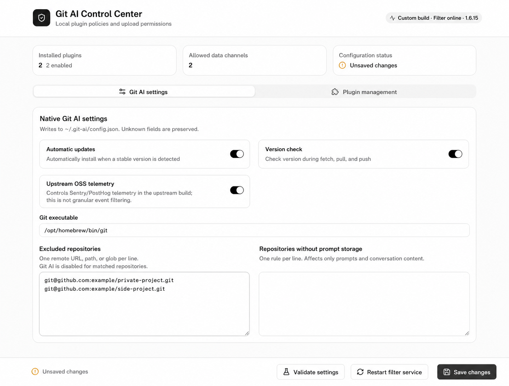
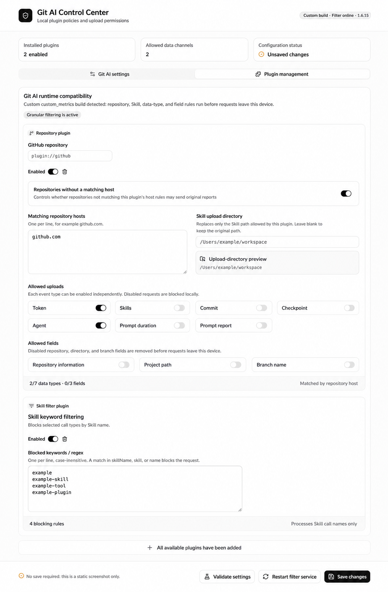

# Git AI Control Panel

[Chinese documentation](README.zh-CN.md)

Git AI Control Panel is a local settings and upload-policy manager for Git AI on macOS, Linux, and Windows. It lets you control report event types and fields by repository host without manually editing JSON or writing a script for every privacy rule. The React/Vite control page listens only on `127.0.0.1:38742`; it is never exposed to your LAN or the public internet.

> [!IMPORTANT]
> The project detects both custom `custom_metrics` builds and the upstream [`git-ai-project/git-ai`](https://github.com/git-ai-project/git-ai), but their capabilities differ. Repository-level event controls, field redaction, and Skill filtering require the `custom_metrics` extension point. Read the [compatibility guide](COMPATIBILITY.md) before installing.

## Features

- Manage Git AI automatic updates, version checks, repository exclusions, and prompt exclusions.
- Apply a common policy to GitHub, GitLab, Gitee, or another Git host.
- Control Token, Skills, Commit, Checkpoint, Agent, prompt-duration, and prompt-report uploads independently.
- Remove repository, project-path, and branch fields before a report leaves the device.
- Replace the reporting directory for allowed Skill uploads with a fixed directory.
- Block Skills by keyword or regular expression.
- Add repository plugins with a global fallback plus repository, directory, branch, and priority matching.
- Redact or block sensitive content such as API keys, private keys, and credentials.
- Govern Agent and model usage with allowlists, regex rules, audit mode, or blocking mode.
- Review the last 24 hours of locally blocked reports without storing report bodies.
- Show Git AI and filter-service status, version, and update time.

## Screenshots

### Native Git AI settings



### Plugin management



## Quick start

### 1. Run one command

macOS, Linux, and Windows are supported. You need Node.js 18+, Python 3, and Git AI installed in its default location:

```text
macOS / Linux: ~/.git-ai/bin/git-ai
Windows:       %USERPROFILE%\.git-ai\bin\git-ai.exe
```

Then run:

```bash
npx git-ai-control
```

The first run downloads the latest version, installs local services, and opens the control center. Later runs reuse the active local control center when it is already running. If the browser does not open automatically, visit:

```text
http://127.0.0.1:38742
```

The installer detects whether Git AI supports `custom_metrics`, backs up original reporting endpoints for the current user only, keeps existing `config.json` and `filter_plugins.json`, installs the control page and filter runtime, and waits for both local health checks.

| OS | Service manager | Requirement |
| --- | --- | --- |
| macOS | LaunchAgent | Current graphical user session |
| Linux | systemd user | Available systemd user session |
| Windows | Task Scheduler | Current user can create a logon task |

### 2. Configure a repository policy

For example, to allow only Token uploads for private GitHub repositories:

1. Add or open a repository plugin.
2. Enter `github.com` under **Matching repository hosts**.
3. Enable **Token** only; disable Skills, Commit, Checkpoint, Agent, prompt duration, and prompt reports.
4. Disable repository information, project path, and branch name.
5. Save changes.

Specific rules are matched before the global **All repositories** rule. Higher priorities win; equal priorities follow plugin list order. Repository, directory, and branch conditions must all match when populated.

### 3. Configure sensitive-content and Agent/model protection

From **Plugin management**, add either of these independent plugins:

1. **Sensitive data redaction** — select event types, built-in rules, and custom regex; then redact or block matching reports.
2. **Agent / model governance** — configure allowed Agents, models, and blocking regex. Start with audit mode, then use blocking mode if appropriate.

### 4. Configure Skill filtering

1. Add the **Skill filter plugin**.
2. Enable it.
3. Enter one keyword or regular expression per line.
4. Save changes.

### 5. Verify local services

Use **Validate settings** in the page, or run:

```bash
curl -fsS http://127.0.0.1:38742/api/status
curl -fsS http://127.0.0.1:38741/health
```

## How it works

The project does not modify the `~/.git-ai/bin/git-ai` binary. When the `custom_metrics` extension point is available, the installer redirects Git AI custom reporting endpoints to the local filter service:

```text
Git AI
  -> ~/.git-ai/custom_metrics.json
  -> http://127.0.0.1:38741
  -> reads ~/.git-ai/filter_plugins.json
  -> reads ~/.git-ai/upstream_metrics.json
  -> blocks, or redacts and forwards to the original reporting service
```

Saving from the control page only updates:

- `~/.git-ai/config.json` — native Git AI settings;
- `~/.git-ai/filter_plugins.json` — repository and Skill filter policies.

The filter runtime is installed from `plugins/upload-filter/plugin_filter_runtime.py`. The page does not generate or modify the Python runtime; `~/.git-ai` contains only the installed copy and user configuration.

## Files

| Item | Location |
| --- | --- |
| Filter runtime source | `plugins/upload-filter/plugin_filter_runtime.py` |
| Cross-platform installer | `scripts/install.mjs`, `scripts/uninstall.mjs` |
| Service adapters | `scripts/platform-services.mjs` |
| Native Git AI configuration | `~/.git-ai/config.json` |
| Plugin policy | `~/.git-ai/filter_plugins.json` |
| Original reporting-endpoint backup | `~/.git-ai/upstream_metrics.json` |
| Installed filter runtime | `~/.git-ai/filters/plugin_filter_runtime.py` |
| Installed control page | `~/.git-ai/control-panel` |

## Uninstall

```bash
npx git-ai-control uninstall
```

Uninstall stops the two services, removes this project's installed runtime copies, and restores the original Git AI reporting endpoints. It keeps `config.json`, `filter_plugins.json`, and logs.

## Contributing

Contributions are welcome, especially compatibility verification for different Git AI versions, independent plugin types, test coverage, documentation, interaction, and accessibility improvements.

```bash
cd frontend/git-ai-control-panel
npm ci
npm run lint
npm run build
cd ../..
npm run check
```

When opening a pull request, explain the scenario, configuration or filtering impact, validation commands, and include before/after screenshots for UI changes.

## Releases

The project publishes one cross-platform npm package. Pushing a Git tag matching the `package.json` version triggers GitHub Actions to validate macOS, Ubuntu, and Windows, build the frontend once, verify committed static assets, and publish to npm through Trusted Publishing (OIDC).

## Security boundaries

- The web service binds only to loopback.
- Git AI API keys and other sensitive fields are not read or shown.
- Original reporting endpoints are never committed to source; they are stored only in a local user configuration with `0600` permissions.
- Saves use temporary-file replacement to avoid partial configuration writes.
- The page rejects modification requests from non-page origins.
- If plugin configuration is missing or invalid, the default GitHub policy remains fully blocking.
- Without the granular filtering extension point, the page reports native-settings compatibility instead of claiming filtering is active.
