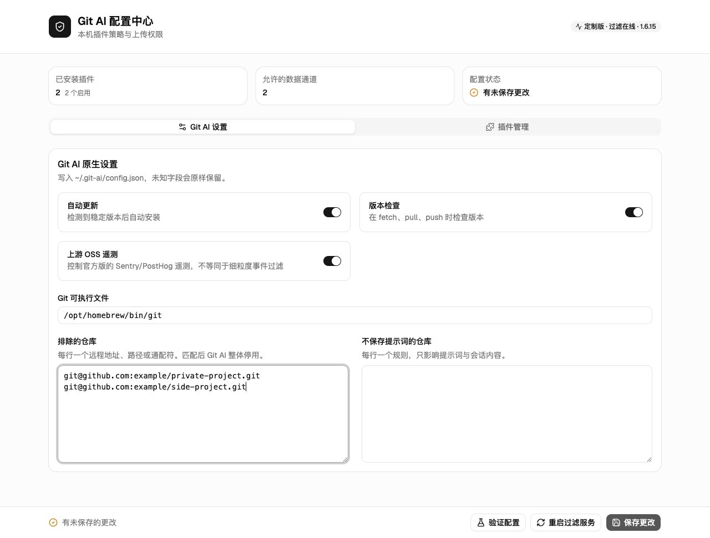
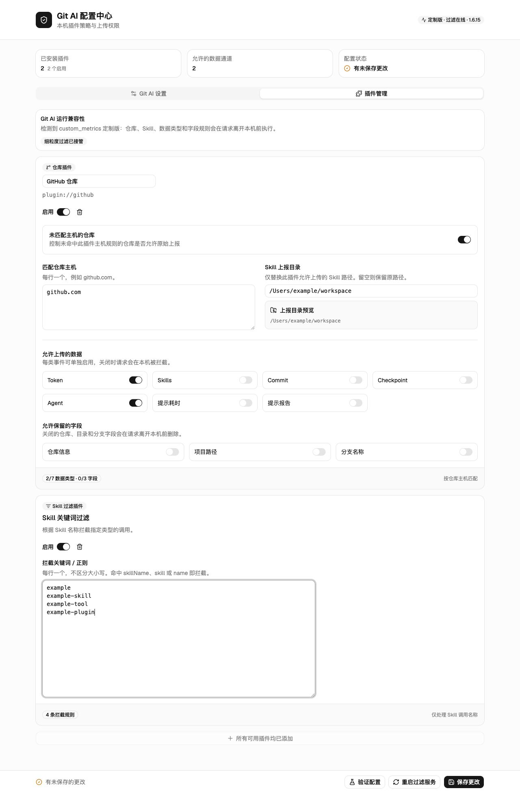

# Git AI Control Panel

公司统一安装了 Git AI，但不想让私人 GitHub 项目的仓库名、路径、分支或 Skill 使用情况被上报？可以试试 Git AI Control Panel。

它是一个支持 macOS、Linux 和 Windows 的 Git AI 本地配置与上传策略管理页面：不用手改 JSON，也不用为每条隐私规则编写脚本，就能按仓库主机控制允许上传的数据类型和字段。前端使用 React、Vite 与 shadcn/ui，Web 服务只监听 `127.0.0.1:38742`，不会向局域网或公网开放。

> [!IMPORTANT]
> 项目可以识别 `custom_metrics` 定制版和官方 [`git-ai-project/git-ai`](https://github.com/git-ai-project/git-ai)，但两者支持层级不同。仓库级事件开关、字段脱敏和 Skill 过滤目前需要 `custom_metrics` 扩展点；官方版只能管理 Git AI 已公开的原生配置。安装前请阅读[兼容性说明](COMPATIBILITY.md)。

## 功能

- 可视化管理 Git AI 自动更新、版本检查、仓库排除和提示词排除；
- 通过“匹配仓库主机”统一处理 GitHub、GitLab、Gitee 或其他 Git 服务；
- 分别控制 Token、Skills、Commit、Checkpoint、Agent、提示耗时和提示报告；
- 可删除仓库信息、项目路径和分支名称等敏感字段；
- 可将允许上传的 Skill 项目目录替换为固定目录；
- 可按关键词或正则拦截指定 Skill；
- 仓库插件可按不同主机添加多个，并支持全局兜底、仓库、目录、分支与优先级；
- 敏感内容脱敏插件可识别 API Key、私钥、凭据，并按规则脱敏或拦截；
- Agent / 模型治理插件支持允许名单、阻止正则及审计/拦截模式；
- Skill、敏感内容和 Agent / 模型治理均使用独立配置表单；
- 支持配置验证、运行状态检查和本机过滤服务重启。

## 界面截图

### Git AI 原生设置



### 插件管理



仓库插件可以同时配置匹配主机、允许上传的数据类型和允许保留的字段，也可以按不同主机添加多个。主机规则重叠时按列表顺序使用第一个命中插件；Skill 过滤插件使用独立表单管理名称规则，且只能添加一次。

插件管理页面按添加顺序展示全部插件。无论添加仓库插件还是独立插件，新卡片都会追加到现有列表最后；这只影响页面展示顺序，不改变仓库规则的匹配优先级。

## 快速开始

### 1. 一条命令启动

支持 macOS、Linux 和 Windows，需要 Node.js 18+、Python 3，并要求 Git AI 已安装在默认目录：

```text
macOS / Linux: ~/.git-ai/bin/git-ai
Windows:       %USERPROFILE%\.git-ai\bin\git-ai.exe
```

确认文件存在后运行：

```bash
npx git-ai-control
```

首次运行时，该命令会自动下载最新版本、安装本机服务，并打开 Git AI 配置中心；之后检测到已运行的配置中心时，会直接复用现有进程。

首次安装过程会：

1. 识别当前 Git AI 是否支持 `custom_metrics` 扩展；
2. 将原始上报端点备份到仅当前用户可读的本机配置；
3. 安装控制页面和上传过滤运行时；
4. 保留已有的 `config.json` 与 `filter_plugins.json`；
5. 通过当前系统的用户级服务管理器创建并启动两个本机服务；
6. 等待控制页面和过滤服务通过健康检查。

如果浏览器没有自动打开，可以手动访问：

```text
http://127.0.0.1:38742
```

页面顶部会显示当前 Git AI 发行版、过滤接管状态和服务状态。

各系统使用的服务管理方式：

| 系统 | 服务管理器 | 使用条件 |
| --- | --- | --- |
| macOS | LaunchAgent | 当前图形用户会话 |
| Linux | systemd user | 可用的 systemd 用户会话 |
| Windows | 任务计划程序 | Windows 10/11，当前用户可创建登录任务 |

### 2. 配置仓库插件

以“GitHub 私人仓库只允许上传 Token”为例：

1. 在“仓库插件”中添加或打开现有仓库插件；
2. 在“匹配仓库主机”中填写 `github.com`；
3. 只打开 `Token`，关闭 `Skills`、`Commit`、`Checkpoint`、`Agent`、提示耗时和提示报告；
4. 关闭“仓库信息”“项目路径”和“分支名称”；
5. 保存配置。

同一个仓库插件也可以填写多个主机，每行一个；也可以为不同主机分别添加仓库插件。GitLab、Gitee 和自建 Git 服务不需要单独开发插件。

仓库策略会先匹配特定规则，再匹配“全部仓库”全局规则；特定规则之间优先级数字越大越靠前，同优先级按插件列表顺序处理。仓库、目录、分支同时填写时需要全部命中。

### 3. 配置敏感内容与 Agent

在“插件管理”中可分别添加以下独立插件：

1. “敏感内容脱敏”：选择作用事件、内置规则和自定义正则；命中后可脱敏或阻止上报；
2. “Agent / 模型治理”：配置允许的 Agent、模型与阻止正则；先使用“仅审计”确认命中情况，再按需改为阻止。

### 4. 配置 Skill 过滤插件

需要按名称拦截 Skill 时：

1. 添加“Skill 过滤插件”；
2. 打开插件；
3. 每行填写一个关键词或正则；
4. 保存配置。

Skill 过滤插件只负责名称规则。仓库匹配、上传类型和目录替换仍由仓库插件负责。

### 5. 验证配置

点击页面中的“验证配置”。结果会通过右上角 Toast 显示，不会占用配置表单空间。

也可以在终端检查两个本机服务：

```bash
curl -fsS http://127.0.0.1:38742/api/status
curl -fsS http://127.0.0.1:38741/health
```

## 工作方式

本项目不会修改 `~/.git-ai/bin/git-ai` 二进制。检测到 `custom_metrics` 扩展点后，安装脚本会将 Git AI 的自定义上报端点指向本机过滤服务：

```text
Git AI
  -> ~/.git-ai/custom_metrics.json
  -> http://127.0.0.1:38741
  -> 读取 ~/.git-ai/filter_plugins.json
  -> 读取 ~/.git-ai/upstream_metrics.json
  -> 拦截，或脱敏后转发至原上报服务
```

两个页签中的“查看配置”会重新读取当前磁盘内容，不会显示未保存的表单修改。Git AI 原生配置只展示本页面安全管理的字段，插件策略展示完整已写入策略。

控制页面保存时只更新：

- `~/.git-ai/config.json`：Git AI 原生设置；
- `~/.git-ai/filter_plugins.json`：仓库插件和 Skill 过滤插件策略。

过滤逻辑来自仓库中的 `plugins/upload-filter/plugin_filter_runtime.py`。控制页面不会动态生成或改写 Python 脚本，`~/.git-ai` 只保存安装副本和用户配置。

## 文件位置

| 内容 | 位置 |
| --- | --- |
| 过滤运行时源码 | `plugins/upload-filter/plugin_filter_runtime.py` |
| 跨平台安装器 | `scripts/install.mjs`、`scripts/uninstall.mjs` |
| 服务适配器 | `scripts/platform-services.mjs` |
| Git AI 原生配置 | `~/.git-ai/config.json` |
| 插件策略 | `~/.git-ai/filter_plugins.json` |
| 原上报端点本机备份 | `~/.git-ai/upstream_metrics.json` |
| 过滤运行时安装副本 | `~/.git-ai/filters/plugin_filter_runtime.py` |
| Web 服务安装副本 | `~/.git-ai/control-panel` |
| macOS 服务定义 | `~/Library/LaunchAgents/com.git-ai.*.plist` |
| Linux 服务定义 | `~/.config/systemd/user/git-ai-*.service` |
| Windows 服务定义 | `%USERPROFILE%\.git-ai\services\*.ps1` 与任务计划程序 |

## 卸载

```bash
npx git-ai-control uninstall
```

卸载命令会停止两个服务、删除本项目安装的程序副本，并将上报端点恢复为 Git AI 原地址。`config.json`、`filter_plugins.json` 和日志会保留。

## 参与贡献

欢迎提交 Issue 和 Pull Request，尤其欢迎：

- 补充不同 Git AI 版本的兼容性验证；
- 新增与仓库过滤不同类型的独立插件；
- 改进过滤规则的测试覆盖；
- 修正文档、交互和无障碍问题。

开发前请先 Fork 仓库并创建主题分支。前端源码位于 `frontend/git-ai-control-panel`，shadcn/ui 组件位于 `src/components/ui`。

```bash
cd frontend/git-ai-control-panel
npm ci
npm run lint
npm run build
cd ../..
npm run check
```

提交 Pull Request 时请说明：

1. 解决的问题和使用场景；
2. 对配置结构或过滤行为的影响；
3. 已执行的验证命令；
4. 涉及界面变化时附上前后截图。

新增插件类型时，请为它设计独立的数据结构和配置表单；不要复用仓库插件表单来表达无关能力。涉及上报兼容性时，应基于实际 Git AI 版本和请求路径验证，避免把“页面可配置”误写成“运行时已接管”。

## 发布

项目只发布一个跨平台 npm 包，不分别生成 macOS、Linux 或 Windows 安装包。推送与 `package.json` 版本一致的 Git 标签后，GitHub Actions 会：

1. 在 macOS、Ubuntu 和 Windows 上检查同一份安装器与运行时源码；
2. 在 Ubuntu 上只构建一次前端静态资源；
3. 确认构建产物与仓库内容一致；
4. 通过 npm Trusted Publishing（OIDC）发布到 npmjs.com。

发布工作流不使用长期 npm Access Token。npm 包需要将 `.github/workflows/publish.yml` 配置为可信发布者。

## 安全边界

- Web 服务只绑定本机回环地址；
- 不读取或展示 Git AI API key 等敏感字段；
- 原始上报端点不会写入项目源码，只保存在权限为 `0600` 的本机配置中；
- 配置保存采用临时文件替换，避免写入中断产生不完整文件；
- 页面没有跨域权限，拒绝非本页面来源的修改请求；
- 插件配置缺失或损坏时，GitHub 默认策略保持全部阻断；
- 官方版缺少细粒度过滤扩展点时，页面会显示“仅原生配置兼容”，不会把空闲代理误报为已接管。
